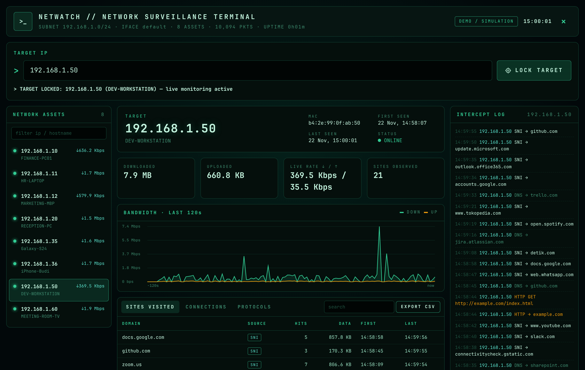

# NETWATCH — Terminal Pemantau Jaringan Kantor

Dashboard bergaya "secure terminal" untuk memantau perangkat di jaringan kantor:
cukup masukkan **IP address** perangkat untuk melihat pemakaian bandwidth, situs yang
dibuka, koneksi aktif, dan protokol yang dipakai, secara live.



## Apa yang bisa dilihat

| Data | Sumber | Keterangan |
|---|---|---|
| Upload / download per perangkat, grafik 120 detik | Semua paket IP | Akurat |
| **Situs yang dibuka (domain)** | TLS SNI, DNS query, HTTP Host | Contoh: `www.youtube.com`, `mail.google.com` |
| URL lengkap | HTTP biasa (`http://`) saja | Situs HTTPS hanya terlihat domainnya; isi halaman & path terenkripsi |
| Koneksi (IP:port tujuan, layanan, volume) | Header TCP/UDP | Dipetakan ke domain lewat jawaban DNS |
| Protokol (HTTPS, QUIC, DNS, SSH, RDP, VPN…) | Port | |
| MAC address, hostname | Ethernet, DHCP, reverse DNS | |
| Log intercept real-time | Semua di atas | |

Fitur lain: daftar semua aset di jaringan, export CSV riwayat situs per perangkat,
login operator (sesi tidak disimpan, kunci 5 menit setelah 5x gagal).

## Syarat penting: posisi komputer pemantau

Aplikasi ini **hanya bisa melihat lalu lintas yang benar-benar melewati kartu jaringan
komputer tempat ia berjalan**. Di jaringan switch biasa, PC biasa hanya melihat trafiknya
sendiri. Pilih salah satu:

1. **Port mirroring / SPAN** (disarankan) — di managed switch, mirror port uplink ke router
   ke port tempat komputer NETWATCH dicolok.
2. **Jalankan di gateway** — mini PC Linux yang menjadi router/gateway kantor.
3. **Router yang bisa mirror trafik** — misalnya MikroTik *Packet Sniffer → streaming* /
   *mangle action=sniff-tzsp* ke komputer NETWATCH, atau OpenWrt dengan port mirror.

> Bila browser memakai **DNS-over-HTTPS** atau **VPN**, domain via DNS tidak terlihat
> (SNI biasanya masih terlihat, kecuali VPN). Matikan DoH via kebijakan browser/GPO
> dan blokir VPN pribadi bila ingin data lengkap.

## Instalasi & menjalankan

Butuh Python 3.10+.

```bash
cd netwatch
pip install -r requirements.txt
```

Coba dulu dengan **mode demo** (data simulasi, tanpa hak admin):

```bash
NETWATCH_PASS=gantiPassword python3 -m netwatch --demo
```

Buka `http://127.0.0.1:8787`, login `admin` / password di atas.

Mode **live** (perlu root/Administrator; di Windows install [Npcap](https://npcap.com)):

```bash
sudo NETWATCH_USER=admin NETWATCH_PASS='password-kuat' python3 -m netwatch --iface eth0 --subnet 192.168.1.0/24
```

| Opsi | Fungsi |
|---|---|
| `--subnet CIDR` | Rentang IP kantor (boleh diulang). Default `192.168.1.0/24` |
| `--iface NAME` | Interface yang di-capture (mis. `eth0`, `enp3s0`, `Ethernet`) |
| `--host` / `--port` | Alamat dashboard. Default `127.0.0.1:8787` (hanya lokal) |
| `--demo` | Data simulasi |

Jika `NETWATCH_PASS` tidak diset, password acak dibuat saat start dan dicetak di konsol.
Untuk membuka dashboard dari PC lain gunakan `--host 0.0.0.0`, sebaiknya hanya di
jaringan admin / di belakang VPN, karena koneksi dashboard tidak memakai HTTPS.

## Catatan hukum & etika

Memantau trafik karyawan menyentuh data pribadi. Di Indonesia, UU No. 27/2022 tentang
Pelindungan Data Pribadi berlaku. Pastikan ada **kebijakan tertulis penggunaan
jaringan kantor** yang diketahui karyawan, pantau hanya perangkat/jaringan milik
perusahaan, batasi akses dashboard ke admin yang berwenang, dan jangan simpan data lebih
lama dari yang diperlukan (NETWATCH menyimpan data di memori saja; hilang saat restart).

## Struktur

```
netwatch/
  netwatch/server.py    # HTTP server, API JSON, login
  netwatch/capture.py   # sniffing (scapy): DNS, TLS SNI, HTTP, DHCP
  netwatch/store.py     # statistik per perangkat (in-memory)
  netwatch/demo.py      # generator trafik simulasi
  netwatch/static/      # UI (HTML/CSS/JS tanpa framework)
```
